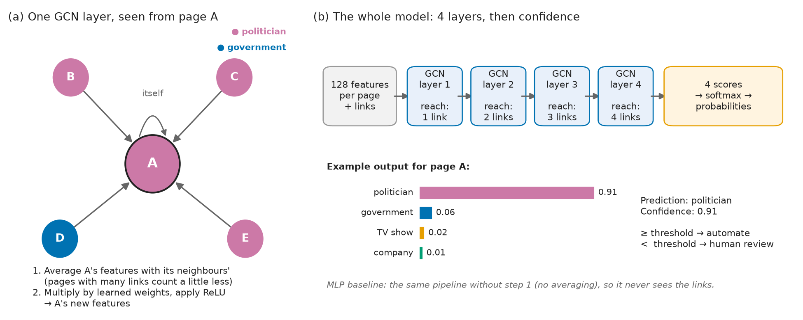
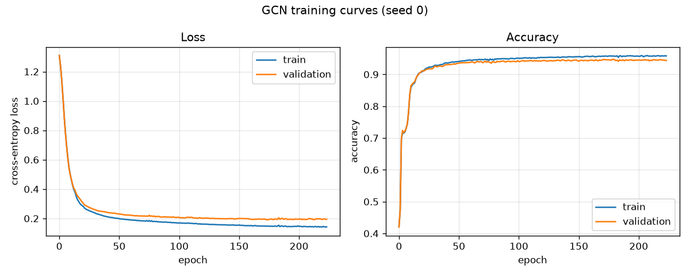
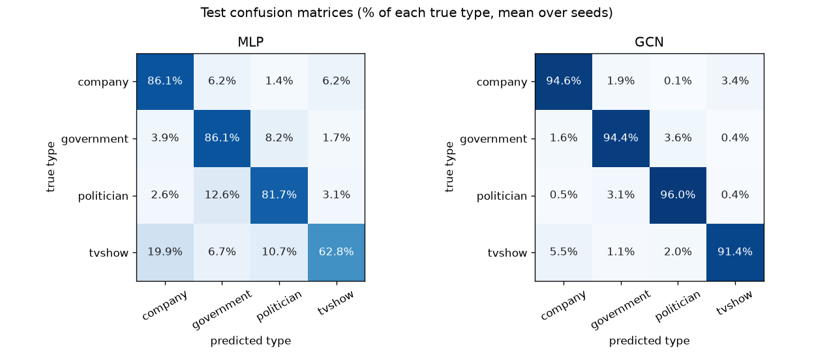
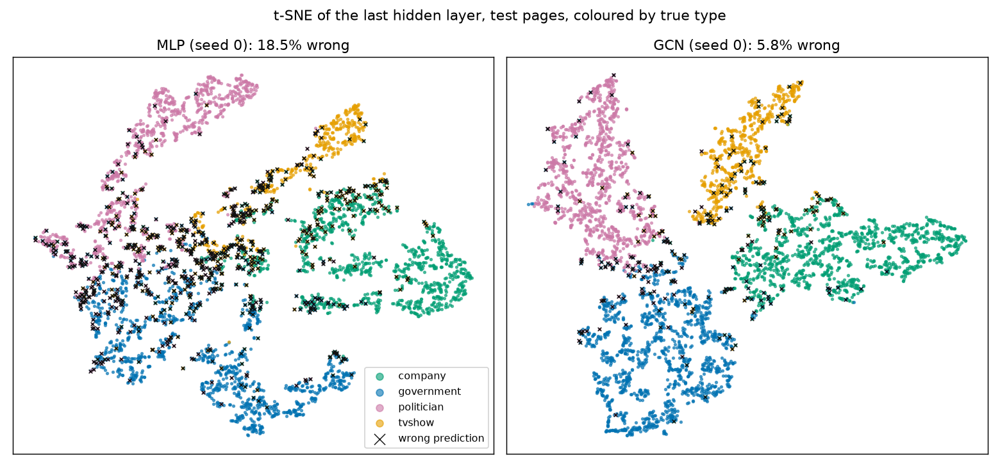
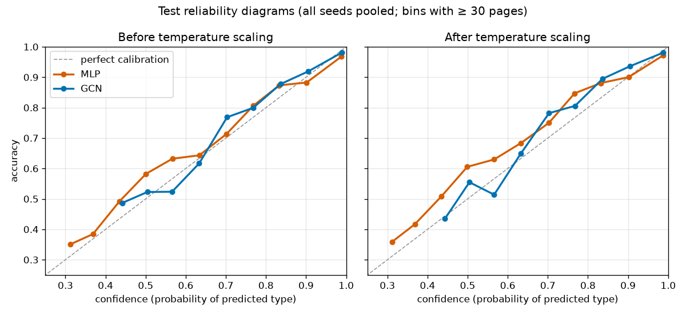
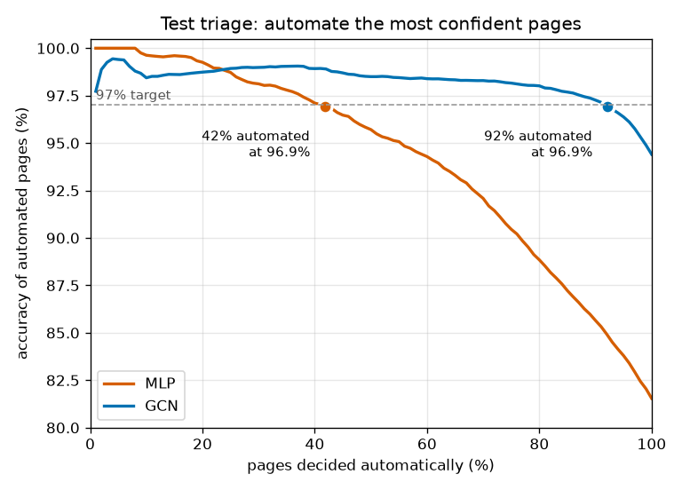
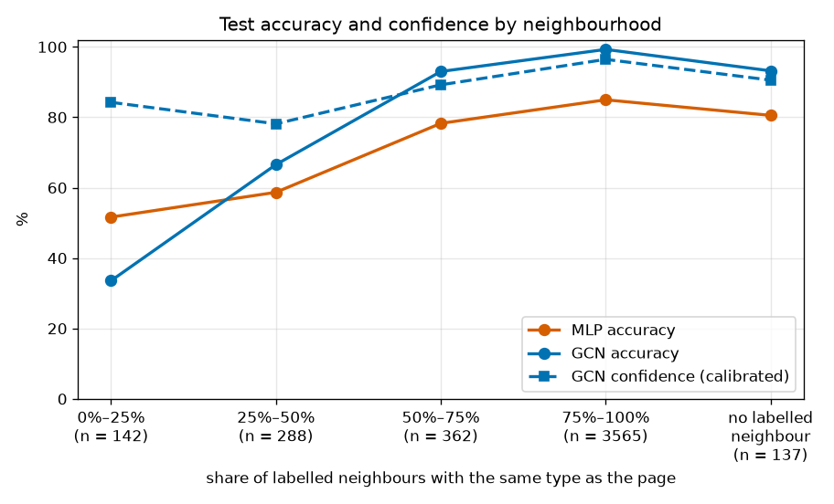

# Multi-layer GCN for Node Classification on the Facebook Page-Page Network

*COMP3710 Pattern Recognition Report — s5042207*

## Overview

**Problem.** Facebook has many official ("verified") pages, and a platform may need to know what kind each one is, for example to apply political-advertising rules to politicians but not to TV shows. This project sorts 22,470 Facebook pages into four types: **TV show, government organisation, company or politician**.

**Data.** Each page comes with two kinds of information:

- **Features:** 128 numbers per page, derived from the text the page owners wrote about themselves.
- **Links:** two pages are linked if they *like each other*. There are 170,823 such links.

**Approach.** A **Graph Convolutional Network (GCN)** [Kipf & Welling, 2017] uses both the features and the links. It is compared with a **multi-layer perceptron (MLP)** that uses the features only, so the difference between the two shows how much the links help.

**Why links should help.** Sociologists have long observed that people tend to connect with others who are like them, "birds of a feather flock together". This tendency is called *homophily* [McPherson et al., 2001]: friends tend to share age, jobs and opinions. Facebook pages behave the same way. 88.5% of links join two pages of the same type: politicians like politicians, and TV shows like other TV shows. A page's neighbours are therefore strong evidence of its type, even when its own description is vague. The flip side, explored in this report, is what happens to the pages whose neighbours are *not* like them.

**Headline result** (test set, mean of 3 runs): the GCN reaches **94.4% accuracy** and the MLP **81.5%**.

**The question beyond accuracy.** In practice, a model's predictions would be accepted automatically only when it is confident, with uncertain pages sent to a human. That only works if the model's confidence can be trusted. The links are also a weakness: for a page whose neighbours are mostly of a *different* type, the GCN is pulled towards the wrong answer, and it may be confidently wrong. The second half of this report tests whether that happens and recommends a rule for when to trust the model.

## How it works



*Figure 1. (a) In each layer, page A combines its own features with those of the pages it is linked to; here three of its four neighbours are politicians, which pulls A towards "politician". (b) Four such layers are stacked, so information travels up to four links; the final scores become probabilities, and the highest one is the model's confidence. The probabilities shown are illustrative.*

**The MLP (baseline)** looks at each page on its own. Its input is the page's 128 features, which it passes through layers. Each layer multiplies by a learned weight matrix and then applies ReLU (negative values set to zero). The last layer outputs 4 scores, one per type.

**The GCN** adds one step to every layer: *before* the multiplication, each page replaces its features with a weighted average of its own features and its neighbours' features. In matrix form, one layer is

$$H^{(l+1)} = \text{ReLU}\left(\hat{A}\, H^{(l)}\, W^{(l)}\right), \qquad \hat{A} = D^{-1/2}(A + I)\,D^{-1/2}$$

| Symbol | Meaning |
|---|---|
| $H^{(l)}$ | the features of every page entering layer $l$ (at the start, the 128 input features) |
| $A$ | the link table: $A_{ij} = 1$ if pages $i$ and $j$ are linked |
| $A + I$ | the links plus a link from each page to itself, so a page keeps its own features in the average |
| $D$ | the number of links of each page (counting the self-link) |
| $\hat{A}$ | the "averaging" matrix: the link between pages $i$ and $j$ gets weight $1/\sqrt{d_i d_j}$, so a page with hundreds of links does not drown out everyone it touches |
| $W^{(l)}$ | the layer's learned weights, shared by all pages |

Each layer reaches one link further. After 4 layers, a page's representation contains information from pages up to 4 links away. The MLP is exactly this network with $\hat{A}$ replaced by the identity matrix, i.e. with no averaging, which is why it is a fair baseline.

**From scores to confidence.** The 4 final scores are turned into probabilities with softmax. The predicted type is the one with the highest probability, and that probability is the model's **confidence**.

**Training.** The whole graph goes through the model at once, but the loss (cross-entropy) is computed only on the 60% of pages whose labels the model may see (the training set). The other pages still contribute their features and links, but not their labels. This is called *semi-supervised* learning. A further 20% (the validation set) is used to stop training at the epoch with the lowest validation loss, and the last 20% (the test set) is used once, at the end, to report results.

## Setup

Tested on a Windows 11 laptop **CPU only** (no GPU needed) with:

| Package | Version |
|---|---|
| Python | 3.12.10 |
| PyTorch | 2.14.1 (CPU build) |
| PyTorch Geometric | 2.8.1 |
| scikit-learn | 1.9.1 |
| NumPy | 2.5.4 |
| Matplotlib | 3.11.2 |

**Python 3.12 is recommended.** It is the version everything was tested on, and also the minimum: NumPy 2.5.4 does not install on older versions. Newer Python versions may work but were not tested.

The same package versions are pinned in `requirements.txt`. Install them into a fresh virtual environment:

```bash
pip install -r requirements.txt --extra-index-url https://download.pytorch.org/whl/cpu
```

The extra index gives the smaller CPU-only build of PyTorch; leave it out to use the default build (with GPU support where available).

**Data.** The dataset is downloaded automatically on first run from the [Gayanku repository](https://github.com/gayanku/facebook_page-page_dataset) into `data/`, which is git-ignored and never committed. It is loaded with `allow_pickle=False`, so the file cannot run code when it is opened. The page-name array, which needs pickle, is read separately with a restricted loader (see *Data and pre-processing*).

## Usage

Run all commands from this folder (`recognition/GCN_s5042207/`).

| Command | What it does | Time (laptop CPU) |
|---|---|---|
| `python dataset.py` | Downloads the data if needed and prints the cleaning report, the data audit, example pages of each type and the class counts in each split | a few seconds |
| `python train.py --model mlp` | Trains the 3-layer MLP baseline with seeds 0, 1 and 2 | about 1 min (≈ 20 s per seed) |
| `python train.py --model gcn` | Trains the 4-layer GCN with seeds 0, 1 and 2 | about 18 min (≈ 6 min per seed) |
| `python tune.py --model lp` | Chooses the label propagation setting on validation | seconds |
| `python predict.py` | Test-set evaluation of all models: every table and figure in *Results* | about 1 min |
| `python tune.py --model mlp` then `--confirm 3` | Settings search on validation only (see *Model selection*) | about 15 min |
| `python tune.py --model gcn` then `--confirm 3` | Same for the GCN | about 3 hours |

To reproduce the results, run `train.py` for both models, then `tune.py --model lp`, then `predict.py`. The `tune.py` searches for the MLP and GCN are only needed to repeat the model selection.

Each training run saves:

| File | Contents | In git? |
|---|---|---|
| `checkpoints/{model}_seed{n}.pt` | the trained weights (best validation epoch) | no (ignored) |
| `figures/{model}_seed{n}_curves.png` | training and validation loss/accuracy curves | yes |
| `results/{model}_results.json` | settings, per-seed scores and mean ± std | yes |

`predict.py` writes every number it reports to `results/test_metrics.json` and its figures to `figures/`.

Every setting can be changed from the command line, e.g. `python train.py --model gcn --layers 2 --seeds 0`. Run `python train.py --help` for the full list (layers, hidden size, dropout, learning rate, weight decay, maximum epochs, early-stopping patience, split seed).

**Reproducibility.** The train/validation/test split uses a fixed seed (42) and is identical for every model and run. Each training seed fixes the weight initialisation and dropout. Repeating the MLP runs on the same machine reproduced the saved results exactly; small differences are possible on other hardware or library versions.

## Data and pre-processing

The dataset is the Facebook Large Page-Page Network [Rozemberczki et al., 2021], in the PyG-style version prepared by Gayanku. Each node is an official Facebook page, each edge is a mutual like between two pages, and each page has 128 features derived from its self-written description. The features are used as provided.

**Cleaning** (printed by `python dataset.py`):

| Step | Edge entries | Notes |
|---|---|---|
| In the file | 342,004 | each link is stored twice, once in each direction |
| Self-loops removed | −358 | 179 pages are linked to themselves (each stored twice) |
| Duplicates removed | 0 | none found |
| **Kept** | **341,646** | = **170,823** undirected links |

**Why remove self-loops?** A page "mutually liking itself" is not a real relationship between two pages. The original dataset does not explain these entries; 111 of the 179 are TV-show pages. More importantly, the GCN already adds one self-link to *every* page so that each page keeps its own features in the average (see *How it works*). Keeping the original self-loops would give those 179 pages a double share of their own features, treating them differently from everyone else for no reason.

After cleaning, every page has at least one link (no isolated pages). The number of links per page is very uneven: the median page has 7 links, but the most connected has 709.

**Class balance.** The four types are not equally common:

| Label | Type | Pages | Share | Example pages |
|---|---|---|---|---|
| 0 | Company | 6,495 | 28.9% | ESET, Shapeways, Ford Danmark |
| 1 | Government | 6,880 | 30.6% | U.S. Consulate General Mumbai, NASA Student Launch |
| 2 | Politician | 5,768 | 25.7% | Victor Dominello MP, Eliziane Gama |
| 3 | TV show | 3,327 | **14.8%** | The Voice of China, Poppy Cat, APB FOX |

TV shows are the smallest group. Accuracy alone could hide poor performance on them, so the report also gives **macro-F1**, which weights every type equally, and per-type scores.

**Checking the label names.** The file stores each type as a number (0–3), and the order of names given in the dataset's repository turned out **not** to match the data. The file also contains every page's name, so `python dataset.py` prints example pages of each label (as in the table above). These show the labels are simply in alphabetical order. An earlier draft of this report (including the feasibility review) used the wrong order; models, scores and splits are unaffected because they only ever see the numbers, but all per-type statements have been corrected.

*How the names are read safely:* the name array is stored in Python's *pickle* format, and loading pickle data from the internet can run arbitrary code. `load_page_names()` uses a restricted unpickler that can only rebuild plain NumPy arrays and refuses anything else. The names are only used for these checks and to describe failure cases, never as model input.

## Train, validation and test split

All 22,470 pages and all links are used during training, but labels are split into three groups. This is the standard *transductive* setting for node classification, and it matches the real use case: the platform can see the whole network and only lacks some of the labels.

| Split | Share | Pages | Company | Government | Politician | TV show | Used for |
|---|---|---|---|---|---|---|---|
| Train | 60% | 13,482 | 3,897 | 4,128 | 3,461 | 1,996 | computing the loss (learning) |
| Validation | 20% | 4,494 | 1,299 | 1,376 | 1,154 | 665 | early stopping, choosing settings, fitting calibration |
| Test | 20% | 4,494 | 1,299 | 1,376 | 1,153 | 666 | final results only, used once |

**Why stratified?** The split is made separately within each type, so every split has the same mix (about 15% TV shows in each). A purely random split could, by chance, leave the validation or test set with noticeably fewer TV shows, making the per-type results less reliable.

**Why 60/20/20?** The platform already has many labelled pages, so a large training set is realistic. Validation and test each still have about 4,500 pages, which is large enough to:

- measure accuracy to within about ±0.7 percentage points (95% interval at 94% accuracy);
- give every type, even TV shows, more than 600 test pages;
- support the calibration and confidence-threshold analyses, which divide the test set into smaller groups.

**Preventing leakage.** The split uses a fixed seed (42), so every model and every run sees the same pages in each group. The code checks (`assert`) that every page is in exactly one group. Test labels are never used for training, early stopping, choosing settings or calibration, and analyses that count a page's same-type neighbours use only training and validation labels.

## Model selection

All settings were chosen using **validation results only**. The test set was used once, after everything was fixed, by `train.py`. Code: `tune.py`. Every run is recorded in `results/tune_mlp.jsonl` and `results/tune_gcn.jsonl`.

**Starting point:** the standard recipe of Kipf & Welling (2017): 2 layers, 64 hidden units, dropout 0.5, weight decay 5×10⁻⁴, Adam with learning rate 0.01, and early stopping after 50 epochs without validation-loss improvement.

### Phase 1: every combination, one seed

For each model, 36 combinations were trained: layers {2, 3, 4} × weight decay {0, 5×10⁻⁵, 5×10⁻⁴} × dropout {0, 0.5} × hidden units {64, 128}. The table shows the average validation accuracy of all runs with a given setting:

| Setting | MLP | GCN |
|---|---|---|
| 2 / 3 / 4 layers | 0.798 / 0.801 / 0.799 | 0.934 / 0.944 / **0.947** |
| dropout 0 / 0.5 | 0.789 / **0.809** | 0.940 / **0.943** |
| hidden 64 / 128 | 0.799 / 0.799 | 0.941 / 0.942 |
| weight decay 0 / 5×10⁻⁵ / 5×10⁻⁴ | 0.796 / 0.798 / 0.804 | 0.941 / 0.943 / 0.940 |

- **Depth matters for the GCN, but hardly for the MLP.** Each extra GCN layer lets a page gather information from one link further away. An extra MLP layer only reprocesses the same 128 features of the same page.
- **Dropout 0.5 helps both models**, so it is kept.
- **Hidden size makes no difference**, so the smaller 64 is kept (about half the parameters).
- **Weight decay interacts with depth for the GCN.** At 2 layers, the standard 5×10⁻⁴ *hurts* (0.929 vs 0.938 at 5×10⁻⁵). At 4 layers it makes no difference (0.946–0.947 for all three values). The standard 2-layer recipe was being held back by its own regularisation; with 4 layers that no longer matters, so the standard value is kept.

### Phase 2: confirming the best settings with three seeds

One seed can be lucky. The top 3 combinations of each model, plus the starting point, were rerun with seeds 0, 1 and 2 (validation accuracy and calibration error, mean ± std):

| Model | Setting | Val accuracy | Val ECE |
|---|---|---|---|
| GCN | 4 layers, wd 5×10⁻⁵, dropout 0.5, hidden 128 | 0.948 ± 0.002 | 0.014 ± 0.002 |
| GCN | 4 layers, wd 5×10⁻⁴, dropout 0, hidden 128 | 0.947 ± 0.002 | 0.012 ± 0.001 |
| GCN | 3 layers, wd 5×10⁻⁵, dropout 0.5, hidden 64 | 0.946 ± 0.002 | 0.013 ± 0.0003 |
| GCN | *starting point (2 layers)* | 0.927 ± 0.001 | 0.034 ± 0.0004 |
| MLP | 3 layers, wd 5×10⁻⁴, dropout 0.5, hidden 128 | 0.816 ± 0.005 | 0.035 ± 0.002 |
| MLP | 3 layers, wd 5×10⁻⁵, dropout 0.5, hidden 128 | 0.815 ± 0.002 | 0.037 ± 0.002 |
| MLP | 4 layers, wd 5×10⁻⁵, dropout 0.5, hidden 64 | 0.814 ± 0.004 | 0.025 ± 0.002 |
| MLP | *starting point (2 layers)* | 0.805 ± 0.001 | 0.037 ± 0.002 |

*ECE (expected calibration error) measures how far the model's confidence is from its actual accuracy; lower is better.*

### Decision

The best settings of each model differ by less than their seed-to-seed spread, so choosing between them would be choosing noise. The rule used was: **change as little as possible from the starting point**, which here means changing only the number of layers.

- **GCN: 4 layers.** All the confirmed top settings have 3 or 4 layers and differ only by noise, and 4 layers is the best depth on average in phase 1. With every other setting at the starting point, the 4-layer GCN reached 0.947 ± 0.002 over three seeds (the final `train.py` runs), level with the best. That is 2.0 accuracy points above the starting point (about ten times the seed spread), and it is about three times better calibrated (ECE 0.034 → 0.011 on seed 0).
- **MLP: 3 layers.** With the other settings at the starting point, 3 and 4 layers are tied (0.813 vs 0.814 on seed 0), so the smaller model is used (12,676 vs 16,836 parameters). It gains about 1 point over the starting point. Tuning the baseline with the same budget keeps the comparison fair: the GCN's advantage is not just a better-tuned model against a neglected one.

The final 3-seed runs of `train.py` reproduced these validation results (MLP 0.814 ± 0.001, GCN 0.947 ± 0.002).

**Why not even deeper (or shallower)?** 1 and 8 layers were also checked, with the other settings at the starting point (seed 0):

| Layers | MLP val accuracy | GCN val accuracy | GCN parameters |
|---|---|---|---|
| 1 | 0.761 | 0.854 | 516 |
| 4 | 0.814 | 0.946 | 16,836 |
| 8 | 0.306 | 0.940 | 33,476 |

A 1-layer model is a single linear step and is too simple for either model. At 8 layers the GCN gets slightly *worse* while doubling its parameters and more than tripling its training time (about 10 min per run in `tune.py`, against 3 min for 4 layers). This is consistent with **over-smoothing**: after 8 rounds of averaging, nearby pages of different types start to look alike. The 8-layer MLP failed to learn at all: 0.306 is exactly the share of the largest class (government), meaning it predicts "government" for every page. This is a known difficulty of training deep plain networks without extra help such as residual connections or normalisation layers, which this project deliberately does not add.

*Note on reproducibility:* every run above was made with the final `tune.py` (the GCN search took 2.7 CPU-hours). Its results for the chosen settings match `train.py` exactly (e.g. 0.9459 for the 4-layer GCN, seed 0). An earlier overnight run of the same search, made with a draft of the script that used a different number of CPU threads, is kept in `results/tune_gcn_draft.jsonl`. Single runs differ from it by up to about 0.003, because the number of threads changes the order of floating-point additions, and the top settings swap places within noise, but every conclusion above is the same.

## Results

All numbers are on the **test set** (4,494 pages), as the mean ± standard deviation over 3 training seeds, produced by `python predict.py` (full output in `results/test_metrics.json`). Label propagation (LP) has no random start, so it has a single run.

### Training



*Figure 2. GCN training curves (seed 0). Training and validation loss fall together and level off with a small gap, so the model is not overfitting; training stopped 50 epochs after the best validation loss (epoch 174). The MLP curves (`figures/mlp_seed*_curves.png`) look similar but level off at about 81% accuracy.*

### 1. Overall and per-type accuracy

| | MLP (features only) | GCN (features + links) | LP (links only) |
|---|---|---|---|
| Accuracy | 0.815 ± 0.002 | **0.944 ± 0.003** | 0.935 |
| Macro-F1 | 0.798 ± 0.001 | **0.941 ± 0.003** | 0.932 |
| Macro-AUROC | 0.953 ± 0.001 | **0.990 ± 0.000** | 0.990 |

| Recall by type (share of each type found) | MLP | GCN | Gain |
|---|---|---|---|
| Company | 0.861 | 0.946 | +8.5 |
| Government | 0.861 | 0.944 | +8.3 |
| Politician | 0.817 | 0.960 | +14.3 |
| TV show | 0.628 | 0.914 | **+28.6** |



*Figure 3. Confusion matrices (rows: true type; each row adds to 100%).*

The links add 13 accuracy points, and help most where the description is weakest. The MLP confuses two pairs of types: **TV show → company** (19.9% of TV shows), and **politician ↔ government** (12.6% of politicians are called government). These are genuinely similar descriptions: a TV channel and a media company, or a minister and a ministry. The GCN cuts these errors to 5.5% and about 3%, because a TV show is mostly liked by other TV shows. Label propagation, which uses only the links, is almost as accurate (93.5%), so most of the GCN's advantage comes from the graph. The features add about one point on top.



*Figure 4. t-SNE maps of each model's last hidden layer (test pages, seed 0), coloured by true type; black crosses are wrong predictions.*

The GCN separates the four types into four clean groups, and its mistakes sit on the borders between politician and government, and between company and TV show. In the MLP map, these pairs overlap heavily, which is where most of its 18% errors are.

### 2. Calibration: does the confidence mean what it says?

| | MLP | GCN | LP |
|---|---|---|---|
| ECE before temperature scaling | 0.031 ± 0.003 | **0.014 ± 0.001** | 0.114 |
| Temperature fitted on validation | 1.12 | 1.06 | 0.53 |
| ECE after temperature scaling | 0.041 ± 0.002 | **0.016 ± 0.001** | 0.010 |

*ECE (expected calibration error): pages are grouped by confidence, and the gap between confidence and accuracy is averaged over the groups. An ECE of 0.014 means confidence and accuracy differ by about 1.4 percentage points on average.*



*Figure 5. Reliability diagrams. A perfectly calibrated model follows the dashed diagonal.*

**Overall, the GCN is already well calibrated.** Its temperature is close to 1, and scaling changes almost nothing (0.014 → 0.016, within noise). This agrees with the model selection, where deeper GCNs had lower ECE. Temperature scaling helps a lot where calibration is genuinely off: LP is *under*-confident, and a temperature of 0.53 sharpens it from 0.114 to 0.010. It slightly *hurts* the MLP, which is under-confident at low confidence but not at high confidence (Figure 5); a single temperature cannot fix both. A temperature is fitted to minimise validation loss, not ECE, and the MLP's test loss did improve very slightly (0.514 → 0.513).

### 3. Triage: how many pages can be decided automatically?

On **validation**, for each model, we chose the lowest confidence threshold at which the automatically decided pages were still 97% accurate. That threshold was then applied to the test set:

| | MLP | GCN | LP |
|---|---|---|---|
| Threshold (chosen on validation) | 0.92 | 0.76 | 0.78 |
| Pages decided automatically | 41.8% | **92.1% ± 0.2%** | 89.1% |
| Accuracy of automated pages | 96.9% | 96.9% ± 0.1% | 97.0% |
| Automated mistakes (of 4,494 pages) | 57 | 126 | 122 |
| Accuracy on pages sent to humans | 70.5% | 64.9% | 65.2% |



*Figure 6. Accuracy of the automated pages against the share automated, as the threshold is relaxed. Dots: thresholds chosen on validation.*

The GCN can safely decide more than twice as many pages as the MLP. The pages it sends to humans really are the hard ones (only 65% would have been right). The threshold chosen to give 97% on validation gives **96.9%** on test, a hair below the target, which is the expected behaviour of a threshold tuned exactly to a target on one sample (half the time the next sample comes out slightly below). TV shows are automated least often (89.5%, vs 91–94% for the other types).

Figure 6 also shows something more worrying: **even the GCN's most confident 1% of pages are not error-free** (about 98% accurate). Some of its mistakes are made with near-total confidence.

### 4. The dilemma: where are the confident mistakes?

For every test page, we measured the share of its *labelled* neighbours (training and validation pages only) that have the same type as the page (its **local homophily**):

| Same-type share of labelled neighbours | Test pages | MLP accuracy | GCN accuracy | GCN confidence | GCN automated mistakes |
|---|---|---|---|---|---|
| 0–25% | 142 (3.2%) | 51.6% | **33.6%** | **84.2%** | 70 |
| 25–50% | 288 (6.4%) | 58.7% | 66.6% | 78.1% | 35 |
| 50–75% | 362 (8.1%) | 78.3% | 93.0% | 89.2% | 8 |
| 75–100% | 3,565 (79.3%) | 85.0% | 99.3% | 96.4% | 8 |
| no labelled neighbour | 137 (3.0%) | 80.5% | 93.2% | 90.5% | 5 |



*Figure 7. Test accuracy, and GCN confidence (after temperature scaling), by the share of a page's labelled neighbours that have the same type.*

**This answers the research question.**

- On the 3% of pages whose neighbours are mostly of *other* types, the GCN is right only **one time in three**, worse than the MLP (52%), which ignores the links. Yet it is **84% confident** on average. The links pull these pages towards the wrong type, and the GCN does not know it is being misled.
- These pages are rare, so the overall calibration (ECE 0.014) barely notices them. **A good overall calibration score hides a 50-point gap between confidence and accuracy on a small, identifiable group.**
- The 9.6% of pages with at most half same-type neighbours produce **84% of the GCN's automated mistakes** (106 of 126). A confidence threshold cannot remove them without also sending many correct pages to humans.

### 5. Failure autopsy

The five most confident GCN mistakes (seed 0; all three seeds make the same mistakes):

| Page | True type | GCN says | Labelled neighbours | MLP says | What went wrong |
|---|---|---|---|---|---|
| Senate of Canada | government | politician (1.00) | 218 politician, 1 government | politician (0.94) | A parliament: an institution full of politicians. The description and the links both point to "politician"; the label itself is debatable. |
| Republican Party of Texas | government | politician (1.00) | 16 politician, 1 government | politician (0.99) | A political party: the same boundary case. |
| DIRECTV Puerto Rico | company | TV show (1.00) | 48 TV show, 9 company | **company (0.80)** | A TV provider liked by the shows it carries. **The MLP was right; the links overrode it.** |
| Comedy Central UK | company | TV show (1.00) | 12 TV show, 1 company | TV show (0.99) | A TV channel: a company by label, a TV show by description and links. |
| Laurent Fabius | politician | government (1.00) | 61 government, 10 politician | **politician (1.00)** | A former French Prime Minister, linked mainly to ministries and embassies. **The MLP was right, with full confidence.** |

Two kinds of failure appear:

1. **Boundary cases, where the label itself is debatable** (a parliament, a party, a TV channel). Both models disagree with the label, and arguably so would many people. These are problems of the category definitions, not of the model.
2. **Pages the graph misleads** (DIRECTV, Laurent Fabius): the page's own description is clear and the MLP gets it right, but its neighbours belong to a related type, and averaging over them overrides the evidence. This is exactly the low-homophily failure of Section 4.

### 6. Resources

| | MLP | GCN |
|---|---|---|
| Parameters | 12,676 | 16,836 |
| Prediction for all 22,470 pages | 0.01 s | 0.22 s |
| Training time per run (one seed) | ≈ 19 s | ≈ 6 min |

Peak memory of the whole Python process was **0.71 GB** after loading the graph and all seven models and predicting every page, and 0.82 GB at the end of `predict.py` (including t-SNE and the timing runs).

*Measured by `predict.py` on a Windows laptop CPU: time per epoch × the mean number of epochs actually run (best epoch + 50).*

### Acceptance criteria

| # | Criterion (from the feasibility review) | Result | Met? |
|---|---|---|---|
| 1 | GCN macro-F1 ≥ 0.85 and above the MLP | 0.941 vs 0.798 | ✅ |
| 2 | GCN ECE ≤ 0.05 after temperature scaling | 0.016 | ✅ |
| 3 | ≥ 80% automated at ≥ 97% accuracy (threshold chosen on validation) | 92.1% automated at 96.9% | ⚠️ coverage met; accuracy 0.1 points short |
| 4 | No leakage | disjoint masks asserted; test labels only used to score the finished models (end of `train.py`, and `predict.py`) | ✅ |
| 5 | Training both models < 5 min, < 2 GB, inference < 1 s | ≈ 6.4 min, 0.71 GB, 0.22 s | ⚠️ memory and speed met; training about 1.4 min over |

The two near-misses are reported as they are; the thresholds and settings were not changed after seeing the test results. Criterion 5 was missed because model selection chose a 4-layer GCN, trading a few more minutes of training for 2.0 accuracy points and three times better calibration on validation. Part of the measured epoch time is an extra full-graph evaluation on the training set, used only to draw Figure 2, which a production version would skip.

## Discussion and recommendation

**For the trust-and-safety team:** the GCN is good enough to sort most pages automatically, but its confidence cannot be fully trusted on one identifiable kind of page.

1. **Use the GCN with a confidence threshold**, and send the rest to human review. At the threshold chosen here, about 92% of pages are decided automatically, with about 97% accuracy, while the MLP could only automate about 42% at the same accuracy. Because a threshold set exactly at the target came out slightly short on new data, **set it with a safety margin** (for example, aim for 98% on validation). Figure 6 suggests about 80% of pages could still be automated at that level, but this should be confirmed on fresh data, not on this test set.
2. **Do not rely on confidence alone for politician vs government, or company vs TV show.** Almost all confident mistakes are between these pairs, and they concentrate on pages whose neighbours are mostly of the other type. For the political-advertising use case, the important errors are politicians labelled as government and vice versa. **Audit a random sample of automated politician/government decisions** regularly.
3. **Write clear rules for boundary entities** such as parliaments, political parties and broadcasters. Several "mistakes" are pages where the label itself is debatable; the model cannot be more consistent than the labels it learns from.
4. **Residual risk:** about 2.8% of all pages (126 of 4,494) would be decided automatically and wrongly, mostly with high confidence. On validation, two label-free warning signals were tested (the MLP disagreeing with the GCN, and how many neighbours the GCN predicts to have the same type as the page); neither removed more errors than simply raising the threshold.

**Why does this happen?** A GCN assumes that linked pages are similar. That is true for 88.5% of links, which is why it beats the MLP by 13 points. For a page whose links mostly go to another type, the assumption fails, and because the model has never been told that the assumption *can* fail, its confidence does not drop. Methods designed for this, such as letting the model learn how much to trust each neighbour (GAT), were tried briefly on validation and did not help here (see the feasibility review); models designed for low-homophily graphs [Zhu et al., 2020] are the natural next step.

**Limitations.**
- Results come from one fixed split of one dataset; seeds only vary the training randomness.
- The 0–25% group has only 142 test pages, so its numbers are less precise (±8 points).
- Local homophily uses the page's own true type, so it explains the errors after the fact but cannot be computed for a new, unlabelled page.
- The labels themselves contain debatable cases (Section 5), so part of the "error" is disagreement about categories.
## AI usage disclosure

This project was done with the help of an AI coding assistant (Claude Code, by Anthropic). How it was used:

- **Code:** the assistant drafted `dataset.py`, `modules.py`, `train.py`, `tune.py` and `predict.py` step by step, as requested. I reviewed each piece, ran the code (locally and on Google Colab), and made every commit myself. Every number and figure in this report is produced by the committed code and saved in `results/` and `figures/`.
- **Design decisions** were discussed before they were made. Some came from me: using early stopping against overfitting; removing self-loops because the GCN adds its own (a page would otherwise count itself twice); and widening the settings search to combinations (e.g. no weight decay together with more layers), which found the 4-layer GCN.
- **Checking:** the assistant found that the class-name order given with the dataset did not match the data, by checking the page names (see *Checking the label names*).
- **Learning and writing:** the assistant explained the theory (neural networks, GCN layers, normalisation, calibration) in plain language, and drafted sections of this README, which I reviewed and edited.

## Feasibility Review

*Status as of 27 October 2026, when it was checked off. Kept as it was, except that the type names in the data audit table were corrected afterwards (see* Checking the label names*).*

### 1. User need, scope and acceptance criteria

**User:** a trust-and-safety team at a social platform that must sort verified pages into four categories (politician, government organisation, TV show, company), e.g. to apply political-advertising rules.
**Prototype purpose:** classify pages automatically from their descriptions and their mutual-like links, and send pages the model is unsure about to a human reviewer instead of guessing.
**Dilemma addressed:** does the graph model's confidence actually track correctness, or is it confidently wrong on ambiguous pages, such as pages whose neighbours belong to a different category?

Acceptance criteria (test split, mean over 3 seeds; set before the main experiments, after an initial single-seed smoke test: MLP 0.797, GCN 0.922 test accuracy):

1. **Accuracy:** GCN test macro-F1 ≥ 0.85 and higher than the MLP baseline on identical splits.
2. **Calibration:** after temperature scaling fitted on the validation set only, GCN expected calibration error (ECE) ≤ 0.05.
3. **Triage:** a confidence threshold chosen on validation automates ≥ 80% of test pages at ≥ 97% accuracy, with the rest routed to humans.
4. **Leakage:** train/val/test masks are disjoint (asserted in code), and test labels are never used for loss, early stopping, tuning or calibration.
5. **Resources:** training both models takes < 5 min on a laptop CPU with < 2 GB peak memory, and full-graph inference takes < 1 s.

### 2. Model choice and course concepts

- **Data:** Facebook Large Page-Page Network [Rozemberczki et al., 2021], modified PyG version by Gayanku: 22,470 pages, 128-dim features, 4 classes. Transductive semi-supervised setting with a stratified, fixed-seed train/val/test split.
- **Main model:** multi-layer GCN [Kipf & Welling, 2017], **Normal difficulty**. Each layer averages a page's features with its neighbours' and then applies a learned linear layer, so *k* layers see *k* hops. Starting from the standard 2 layers, a validation-only grid search (layers × weight decay × dropout × hidden size, 36 combinations, top settings confirmed over 3 seeds) selected **4 layers**. Accuracy only starts to drop at 8 layers (over-smoothing).
- **Baseline:** MLP with the same hidden size, dropout, weight decay and training budget, tuned by the same search (**3 layers**). It is the GCN without neighbour averaging, so any difference can be attributed to the graph. Label propagation (graph only, no features) is a second reference.
- **Concepts:** message passing, homophily [Zhu et al., 2020], calibration and temperature scaling [Guo et al., 2017], and GNN under-confidence [Wang et al., 2021].

### 3. Preliminary feasibility evidence

Data audit produced by `dataset.py`:

| Property | Value |
|---|---|
| Nodes / undirected edges | 22,470 / 170,823 (358 self-loops removed), no isolated nodes |
| Classes | company 6,495 · government 6,880 · politician 5,768 · TV show 3,327 (14.8%, minority) |
| Degree | min 1 · median 7 · mean 15.2 · max 709 (heavy-tailed) |
| Edge homophily | 0.885 (class-insensitive 0.819) |

The high homophily suggests neighbour averaging should help overall, while the ~11.5% of cross-class edges are where the confidence dilemma should appear. The dataset author describes the file as a drop-in replacement for PyG's `FacebookPagePage`, but its array names differ, so the PyG class fails to read it; a custom loader was written instead.

**Baseline comparison** (`train.py`, 3 seeds, early stopping on validation loss, laptop CPU):

| Model | Parameters | Val accuracy | Test accuracy | Test macro-F1 |
|---|---|---|---|---|
| MLP, 3 layers (features only) | 12,676 | 0.814 ± 0.001 | 0.815 ± 0.002 | 0.798 ± 0.001 |
| GCN, 4 layers (features + graph) | 16,836 | 0.947 ± 0.002 | 0.944 ± 0.003 | 0.941 ± 0.003 |

The graph adds about 13 accuracy points, far beyond seed-to-seed variation, so the GCN is clearly viable (criterion 1's accuracy target is already met). Validation and test agree closely, so the model selection did not overfit the validation set.

**First look at the dilemma (validation only).** On pages where ≤ 25% of neighbours share the page's type (115 validation pages), the GCN is *worse* than the MLP (31% vs 50% accuracy) yet averages 84% confidence: exactly the confidently-wrong failure the investigation targets. A plain confidence threshold of 0.9 automates 83% of validation pages at 97.9% accuracy, so criterion 3 looks achievable.

**Resources:** one 4-layer GCN run takes about 5 minutes on a laptop CPU (the 2-layer version took about 2), so criterion 5 is borderline. Memory and inference time will be profiled.

### 4. Risks, budget and fallback

| Risk | Mitigation / fallback |
|---|---|
| Tight timeline (deadline 30 Oct) | Core analyses first (calibration, reject rule, failure autopsy). GAT was tried on validation and did not help, so it is reported briefly rather than developed further. |
| Confident errors are invisible to the model itself | Label-free warning signals (MLP–GCN disagreement, predicted-neighbour agreement) were tested on validation and added nothing beyond a higher threshold. Report this honestly as a residual risk that needs human review. |
| GCN training time exceeds the resource target | Cache the graph normalisation (done) and evaluate once per epoch; otherwise report the trade-off against the accuracy gain. |
| Noisy calibration estimates | Average over 3 seeds and report standard deviations. |

**Compute budget:** about 6 CPU-hours so far on a laptop, mostly an overnight hyperparameter search; no GPU needed (Colab as backup).
**Next experiment:** test-set evaluation of the final models: per-class metrics and AUROC, ECE and reliability diagrams before and after temperature scaling (fitted on validation), the confidence-threshold rule, and the local-homophily analysis.

## References

- T. N. Kipf and M. Welling, "Semi-supervised classification with graph convolutional networks," ICLR, 2017.
- M. McPherson, L. Smith-Lovin and J. M. Cook, "Birds of a feather: Homophily in social networks," Annual Review of Sociology, vol. 27, pp. 415–444, 2001.
- B. Rozemberczki, C. Allen and R. Sarkar, "Multi-scale attributed node embedding," Journal of Complex Networks, 2021.
- C. Guo, G. Pleiss, Y. Sun and K. Q. Weinberger, "On calibration of modern neural networks," ICML, 2017.
- J. Zhu et al., "Beyond homophily in graph neural networks: current limitations and effective designs," NeurIPS, 2020.
- X. Wang, H. Liu, C. Shi and C. Yang, "Be confident! Towards trustworthy graph neural networks via confidence calibration," NeurIPS, 2021.
